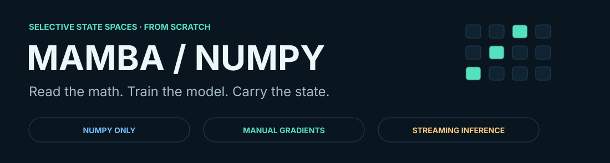
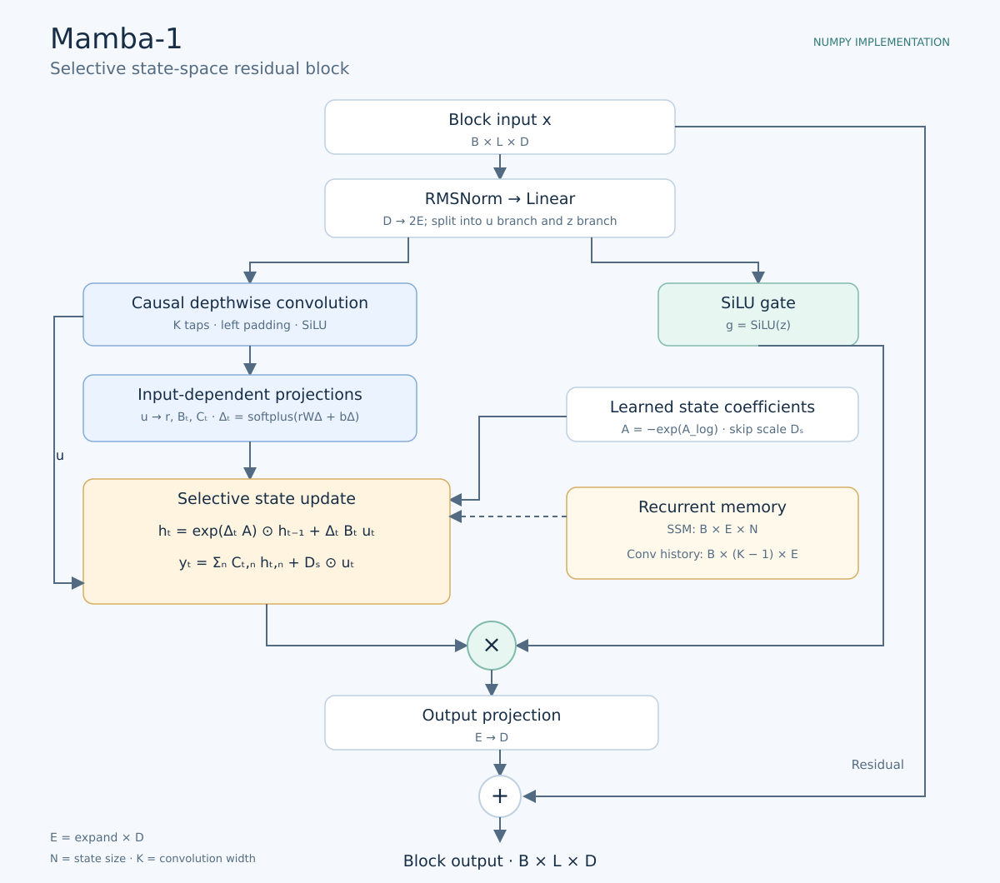
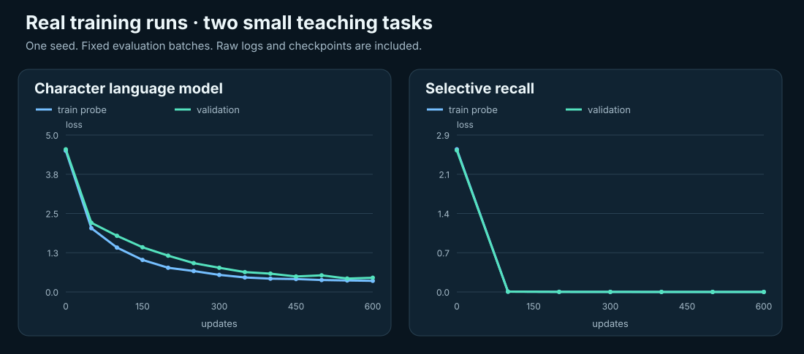
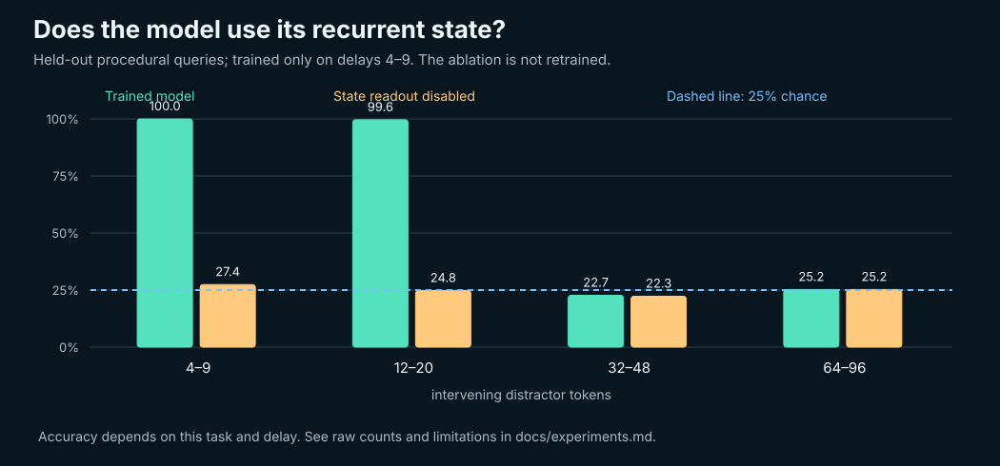
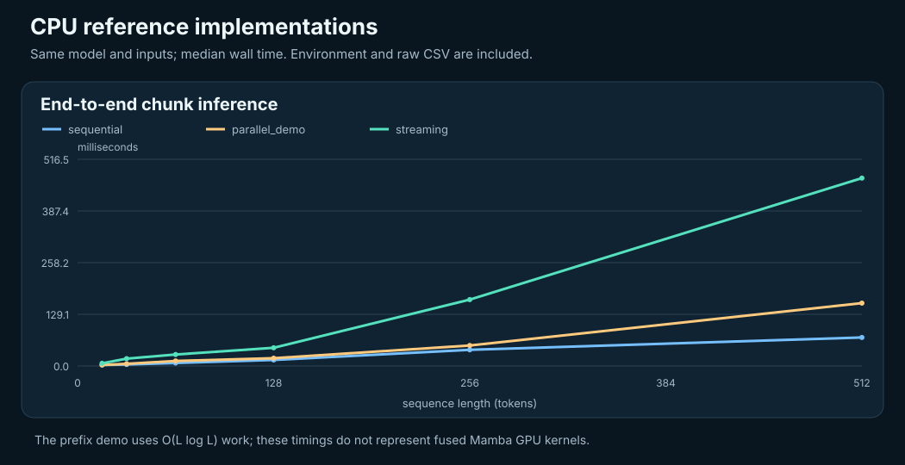

<p align="center">
  
</p>

<p align="center">
  
  
  
</p>

# Mamba, built entirely with NumPy

A trainable **Mamba-1** implementation with hand-written backpropagation,
recurrent text generation, and experiments you can inspect. No deep learning
framework, autograd engine, downloaded model, or GPU is required.

**Author:** [Matin Firoozbakht](https://github.com/matinfirooz)  

The purpose is to make every part of Mamba visible: the selective state update,
its derivatives, and the exact state carried between tokens. The repository
includes small trained demo checkpoints, actual training logs, numerical
checks, diagrams, and commands to reproduce the runs.

## What is implemented

| Part | Included |
| --- | --- |
| Mamba-1 mixer | Expanded input projection, causal depthwise convolution, SiLU, selective SSM, gated output projection |
| Selection mechanism | Input-dependent `Δ`, `B`, and `C`; low-rank time-step projection |
| Deep model | Pre-RMSNorm residual stack, embeddings, final norm, optionally tied vocabulary head |
| Training | Explicit analytic gradients for all weights, AdamW, clipping, warmup, masked cross-entropy |
| Inference | Full sequence, recurrent token step, chunk continuation, and an associative prefix-scan demonstration |
| Text | Unicode character tokenizer, next-token training, temperature/top-k/top-p sampling |
| Experiments | Procedural selective recall, delay sweep, state-readout ablation, CPU timing |
| Reproducibility | Seeds, JSON configs, safe NPZ saves, optimizer/RNG resume, raw CSV logs |
| Hardware study | Floating-point SSM operand/state export with golden outputs |
| Verification | Unit tests, finite-difference gradient checks, causality, streaming equivalence, exact resume |

This follows the **original Mamba-1** block, not Mamba-2/3. It is an educational
CPU implementation, with its own initialization and software layout. The
checkpoints are tiny models trained from scratch; they are not general-purpose
language models or compatible with official pretrained weights.

## Quick start

Extract the ZIP and open the `mamba-numpy` folder in VS Code. Run commands
from that folder.

### Windows / PowerShell

```powershell
py -m venv .venv
.\.venv\Scripts\Activate.ps1
python -m pip install -e .
python examples/quickstart.py
```

If activation is disabled, use `.\.venv\Scripts\python.exe` in place of
`python`; activation is optional.

### Linux / macOS

```bash
python3 -m venv .venv
source .venv/bin/activate
python -m pip install -e .
python examples/quickstart.py
```

NumPy is the only third-party runtime dependency. Editable installation uses
the normal setuptools build backend. You can also run directly from the
repository after `python -m pip install -r requirements.txt`.

### Generate immediately with the bundled model

```bash
python -m mamba_numpy generate --checkpoint checkpoints/text_demo.npz --prompt "mamba" --tokens 200 --temperature 0.65 --top-k 12
```

The output includes the prompt. The tiny character model learns the style and
phrases of the included teaching corpus; expect memorized fragments and errors.

### Train your own text model

```bash
python -m mamba_numpy train-text --data data/tiny_corpus.txt --out runs/text --config configs/tiny.json --steps 600 --log-every 50
python -m mamba_numpy generate --checkpoint runs/text/last.npz --prompt "the state" --tokens 200 --temperature 0.7
python -m mamba_numpy evaluate --checkpoint runs/text/last.npz --data data/tiny_corpus.txt --batches 10
```

Use any sufficiently long UTF-8 text file with `--data your_text.txt`. The
last 15% of characters form a contiguous validation split. Tokenizer fitting
uses training text only; unseen characters map to `<unk>`. The small bundled
corpus intentionally repeats passages, so its validation numbers measure this
teaching distribution rather than broad language generalization.

### Train a memory task

```bash
python -m mamba_numpy train-recall --out runs/recall --config configs/tiny.json --steps 600 --seq-len 32 --batch-size 16 --log-every 100 --save-every 200
python scripts/evaluate_recall.py --checkpoint runs/recall/last.npz --out runs/recall_eval
```

Selected values write to memory; distractors must be ignored; a query asks for
the latest selected value. Loss is computed only at query positions. This is
a small **selective-recall teaching task**, not the original paper's full
selective-copy benchmark. See [experiment details](docs/experiments.md).

### Continue training

```bash
python -m mamba_numpy resume --checkpoint runs/text/last.npz --out runs/text --steps 900 --data data/tiny_corpus.txt
```

`--steps` is the total target update count. Optimizer moments, update count,
and the batch generator's state are restored. The corpus SHA-256 must match.
Existing runs are protected against accidental fresh-training overwrites.

## The architecture



For each expanded channel `e` and state component `n`:

$$
A=-\exp(A_{\log}),\qquad
\Delta_t=\mathrm{softplus}(W_\Delta r_t+b_\Delta)
$$

$$
h_{t,e,n}=\exp(\Delta_{t,e}A_{e,n})h_{t-1,e,n}
+\Delta_{t,e}B_{t,n}u_{t,e}
$$

$$
y_{t,e}=\sum_n C_{t,n}h_{t,e,n}+D_e u_{t,e}
$$

The readout is multiplied by `SiLU(z)` and projected back to model width.
`B_t`, `C_t`, and `Δ_t` depend on the current convolution output. The input
term uses `Δ*B*u`, following the official real scan reference; it is not the
exact ZOH input integral. [The math guide](docs/math.md) explains the shapes,
discretization, associative composition, initialization, and backward equations.

## Use it in Python

```python
import numpy as np
from mamba_numpy import MambaConfig, MambaLM, AdamW, clip_grad_norm

model = MambaLM(MambaConfig(vocab_size=32, d_model=32, n_layers=2, d_state=8))
optimizer = AdamW(model.named_parameters(), lr=0.003)

rng = np.random.default_rng(42)
x = rng.integers(0, 32, (4, 20))
y = rng.integers(0, 32, (4, 20))

loss = model.loss_and_grad(x, y)
clip_grad_norm(model.parameters(), 1.0)
optimizer.step()
print(loss, model.forward(x).shape)  # scalar loss; (4, 20, 32)

# Carry state across chunks.
left, state = model.prefill(x[:, :7])
right, state = model.prefill(x[:, 7:], state)
streamed = np.concatenate((left, right), axis=1)
np.testing.assert_allclose(streamed, model.forward(x), atol=5e-6, rtol=5e-5)
```

For a truly token-at-a-time interface, use `model.step(ids, state)` with
`ids.shape == (batch,)`. `prefill` returns all chunk logits, so output storage
grows with chunk length even though the recurrent state stays fixed. See the
[API guide](docs/api.md) for cache ownership and custom gradients.

## Measured demo results

Both models use width 32, two layers, state size 8, expansion 2, convolution
width 4, float32, and training seed 42. These are actual bundled runs.

| Run | Updates | Parameters | Initial validation loss | Final validation loss | Final validation accuracy |
| --- | ---: | ---: | ---: | ---: | ---: |
| Character language model | 600 | 17,824 | 4.5749 | 0.4559 | 87.96% |
| Selective recall, delays 4–9 | 600 | 17,184 | 2.5794 | 0.000396 | 100.00% |



The fixed validation probes contain 1,536 text targets and 231 recall queries.
The text loss corresponds to character-level perplexity 1.578. Each task has
one training seed. Timing includes evaluation/checkpoint overhead and is
machine dependent; [raw logs](results) and full configs are included.

### Memory has limits



A separate held-out sweep uses seed 20261023 and 16 batches per delay range:

| Distractors before query | Queries | Trained model | State readout disabled |
| --- | ---: | ---: | ---: |
| 4–9 | 934 | 100.00% | 27.41% |
| 12–20 | 824 | 99.64% | 24.76% |
| 32–48 | 749 | 22.70% | 22.30% |
| 64–96 | 761 | 25.23% | 25.23% |

Uniformly guessing among the four possible values gives 25% expected accuracy.
The diagnostic ablation zeros the trained C projections without retraining.
It demonstrates dependence on the state path on the short-delay distribution;
it is not a competitive trained baseline. Long-delay results show the
limitations of this tiny checkpoint and its training distribution.

## Three execution paths

| Path | How it works | Important scope |
| --- | --- | --- |
| `forward(ids)` | Sequential scan with batched projections | Default CPU reference; O(L) work at fixed dimensions |
| `forward(ids, scan_mode="parallel")` | Vectorized Hillis–Steele affine prefix | O(L log L) work, full coefficient tensors; a teaching demo |
| `step` / `prefill` | One token at a time, carrying conv and SSM state | Persistent state independent of processed length |

```bash
python examples/streaming.py
python examples/scan_walkthrough.py
python scripts/benchmark.py --out runs/benchmark --repeats 5
```



The chart measures the same randomly initialized model and inputs on the
recorded CPU; it includes logits and state allocation. These Python/NumPy
paths do not measure official fused Mamba kernels or GPU throughput. Inspect
[the environment](results/benchmark/environment.json) before interpreting timings.

For the tiny model, batch size one, persistent recurrent state is **5,632
bytes (5.5 KiB)**. The formula includes `(K-1)*E` convolution values and `E*N`
SSM values in each layer. At batch size two:

| Sequence length | Persistent recurrent state | Saved SSM history for manual training |
| --- | ---: | ---: |
| 32 | 11 KiB | 264 KiB |
| 512 | 11 KiB | 4,104 KiB |

These are exact array-size calculations, not measured process peak memory.
Weights, logits, other training activations, gradients, optimizer arrays,
and temporary NumPy workspace are additional storage.

## Inspect operands for hardware experiments

```bash
python scripts/export_trace.py --checkpoint checkpoints/text_demo.npz --text "mamba reads a stream" --out runs/trace
```

This exports layer-zero `u`, `Δ`, `A`, `B`, `C`, `D`, gate inputs, all states,
and golden outputs to a pickle-free NPZ, plus a channel-zero CSV. The included
[example trace](results/trace) comes from the trained text model. It is a
**floating-point** software reference; no quantized RTL or hardware performance
claim is implied.

## Verification

```bash
python -m unittest discover -s tests -v
python scripts/gradcheck.py --samples 6 --output runs/gradcheck.json
```

The numerical gradient report checks **165 coordinates** spanning every
parameter tensor and every scan input, including nonzero initial and outgoing
state gradients. In the bundled float64 run the largest absolute error was
`4.40e-10`. Tests also check causality, convolution tap order, masked loss,
full/step/chunk/prefix equivalence, training loss reduction, safe checkpoints,
exact optimizer/RNG resume, and the NumPy-only runtime import boundary.
GitHub Actions is configured for Linux and Windows on Python 3.10 and 3.12;
the included local verification was run on Python 3.12 / NumPy 2.3.5.

To rebuild the distributable archive with a SHA-256 manifest:

```bash
python scripts/package_release.py --output ../mamba-numpy-github.zip
```

## Repository map

| Location | Purpose |
| --- | --- |
| `mamba_numpy/model.py` | Mixer, residual blocks, trainable language model, streaming state |
| `mamba_numpy/scan.py` | Sequential/prefix selective scan and analytic reverse scan |
| `mamba_numpy/nn.py` | Parameters, linear layers, RMSNorm, causal convolution, stable loss |
| `mamba_numpy/optim.py` | AdamW and gradient clipping |
| `mamba_numpy/training.py` | Training, fixed evaluation probes, and exact resume |
| `mamba_numpy/checkpoint.py` | Validated atomic NPZ/JSON checkpoints |
| `mamba_numpy/cli.py` | Training, generation, evaluation, resume, info commands |
| `configs/`, `data/` | Ready-to-run model sizes and original teaching text |
| `checkpoints/` | Two small trained demo checkpoints, including optimizer state |
| `scripts/` | Gradient check, benchmark, recall sweep, SVG rendering, trace export |
| `examples/` | Minimal training API, streaming equivalence, scalar scan walkthrough |
| `tests/` | Numerical and behavioral verification |
| `docs/` | Math, API, experiment methodology, and reading order |
| `results/`, `assets/` | Raw measured evidence and reproducible visualizations |

## Put this package on GitHub

Create an empty repository named `mamba-numpy` under `matinfirooz`. From the
extracted project folder:

```bash
git init -b main
git add .
git commit -m "Implement trainable Mamba-1 from scratch in NumPy"
git remote add origin https://github.com/matinfirooz/mamba-numpy.git
git push -u origin main
```

The ZIP is ready to upload; it does not itself create a hosted repository.

## Credit and license

The architecture belongs to the authors of
[Mamba: Linear-Time Sequence Modeling with Selective State Spaces](https://arxiv.org/abs/2312.00752),
Albert Gu and Tri Dao. The
[official implementation](https://github.com/state-spaces/mamba) is the
reference for architecture and simplified input discretization. This repository
contains an independently written NumPy implementation and original teaching
data. See [LICENSE](LICENSE) for the MIT license and [CITATION.cff](CITATION.cff)
for citation metadata.

```bibtex
@article{gu2023mamba,
  title={Mamba: Linear-Time Sequence Modeling with Selective State Spaces},
  author={Gu, Albert and Dao, Tri},
  journal={arXiv preprint arXiv:2312.00752},
  year={2023}
}
```
